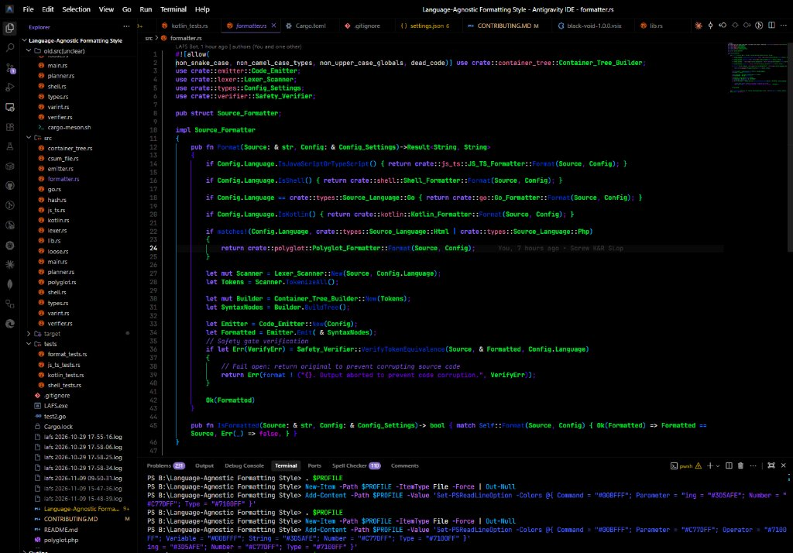
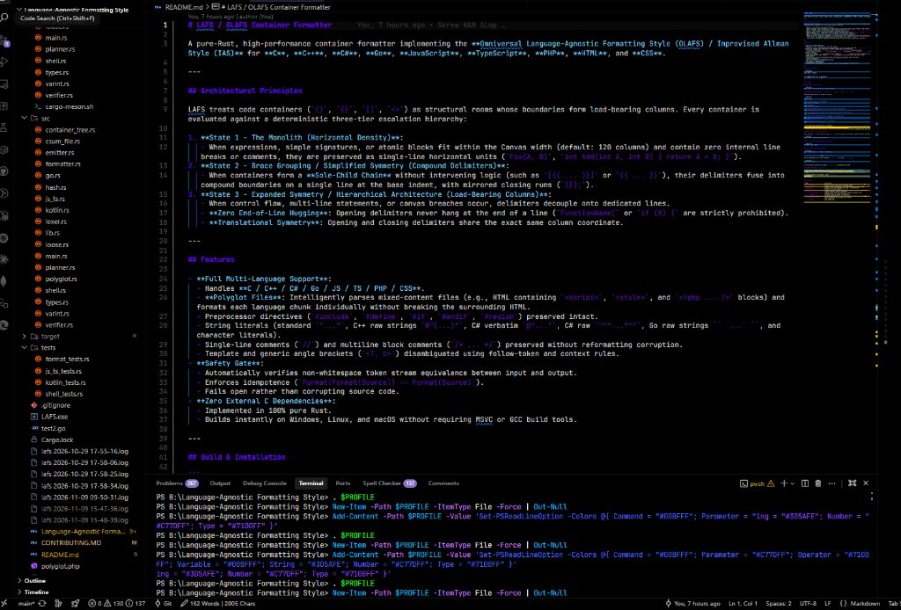

# Spectra Noir for Visual Studio Code & Antigravity IDE

Deep black OLED theme with signature purple and harmonized 6-tier rainbow brace and indentation guide accents.

## Features

- **Pure Deep Black Background**: Maximizes contrast and reduces ocular fatigue.
- **Harmonized 6-Tier Rainbow Braces & Guides**:
  1. Bright Azure Blue (`#00BFFF`)
  2. Pure LAFS Purple (`#7100FF`)
  3. Vibrant Cyan-Azure (`#0077e6`)
  4. Periwinkle Indigo (`#5C7CFA`)
  5. Electric Orchid Violet (`#E040FB`)
  6. Bright Lavender (`#C77DFF`)
- **Matched Indentation Guides**: Inactive guides and bracket pair guides match active scope tiers.

## Preview

### Code Editor & Integrated Terminal

### Markdown Documentation View

## Publisher & Author

- **Author**: Winstead-Inc
- **Publisher**: Winstead-Inc

## License

MIT License
